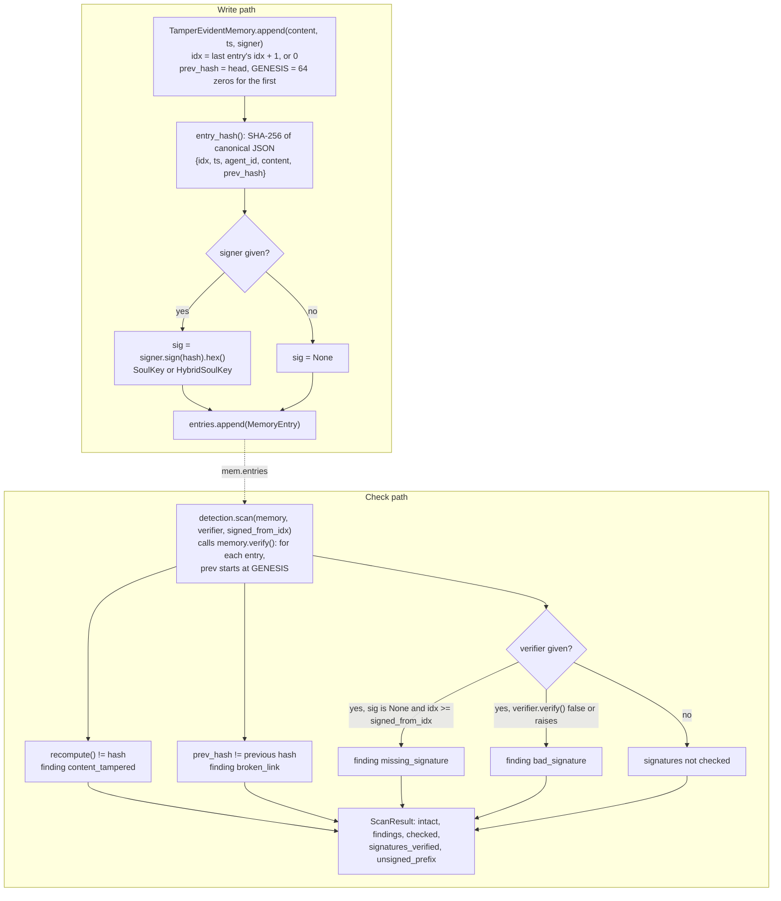
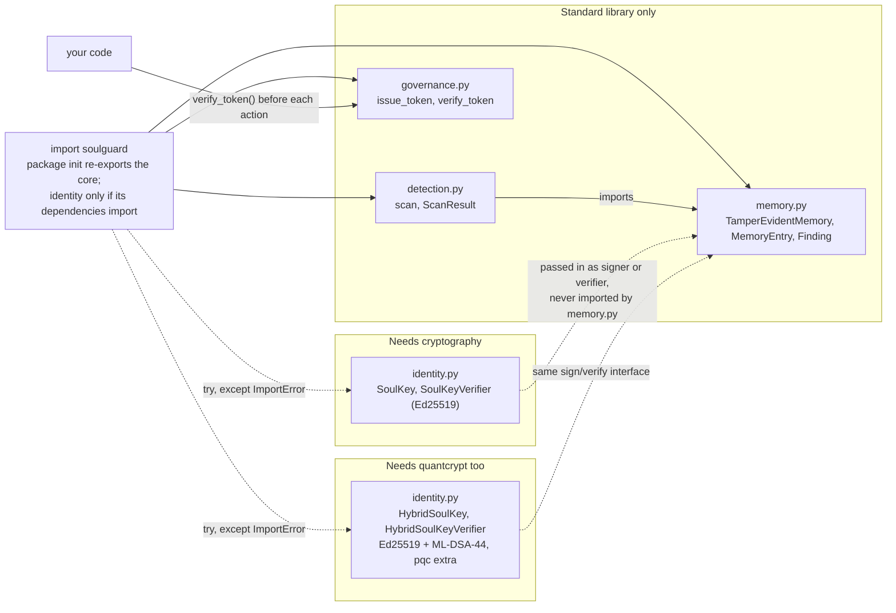
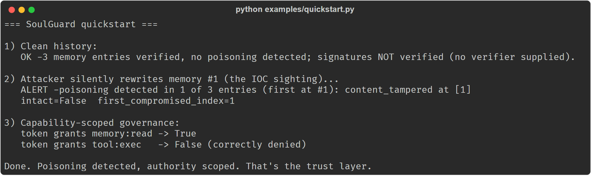
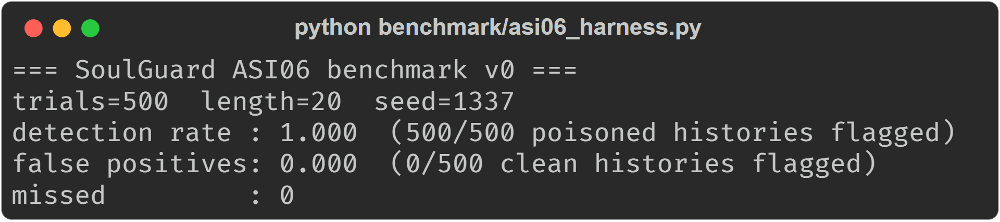

# SoulGuard

**An open trust layer for AI-agent memory and identity.** Tamper-evident memory, per-agent cryptographic identity, capability-scoped governance tokens, and OWASP-**ASI06** memory-poisoning detection, so that after-the-fact edits to a stateful agent's stored history are detected rather than silent.

Apache-2.0 · by [Saluca LLC](https://saluca.com) · extracted from the production stack that runs **Alfred**, a sovereign agentic operating partner.

> **Correction, 2026-10-22.** An accuracy check of this README against the code on `main` found three
> claims that said more than the code does. What the README said, and what is true:
>
> 1. *"Any later edit breaks the chain and is detected."* An in-place edit of a stored entry is
>    detected, and so is a spliced or reordered entry. Two edits are not: **deleting entries from the
>    end of the chain** passes `verify()` and `scan()`, signed or not, because nothing in the chain
>    records its own length; and a chain **rebuilt consistently** by someone with write access passes
>    unless its entries are signed and checked against a public key you pinned out of band. To catch
>    truncation, keep the head hash (`mem.head`) somewhere the writer cannot reach and compare it.
> 2. *"SoulKeys ... catch impersonation & persona drift."* SoulKeys catch forged or stripped
>    signatures. There is no persona-drift detection in the code.
> 3. *"Even a partially-compromised agent can't exceed its authority."* `governance` mints and checks
>    HMAC capability tokens. It does not intercept tool calls: authority is enforced only where your
>    code calls `verify_token()` before acting, and anyone holding the shared secret can mint any scope.
>
> The table below is corrected. The rest of the text is unchanged except for punctuation.

---

## How it works

Two paths, both in `src/soulguard/memory.py`: `append()` writes an entry, and `verify()` (called by `detection.scan()`) re-derives every hash and link from the first entry on.



Nothing on either path records how many entries a chain should have, which is why tail deletion passes (correction 1 above). Governance tokens are a separate path, not shown: `issue_token()` and `verify_token()` in `governance.py` share no state with memory.

## Why

AI agents became *stateful*: they carry persistent **memory**, a durable **identity**, and tool access. That state is also the new attack surface. In 2026 OWASP named **Memory Poisoning (ASI06)** a top-10 agentic risk: once memory is the substrate, an injected lie persists across sessions and the agent later acts on it with full authority, the machine equivalent of confabulation. Input-only guardrails don't see the corrupted state that already lives inside the agent.

SoulGuard makes agent memory and identity **first-class, verifiable, owned primitives**:

| Module | What it does |
|---|---|
| `memory` | **Hash-chained, tamper-evident memory.** An in-place edit, a splice or a reorder breaks the chain and is *detected*, not silent. Tail truncation is not detected without a head hash held out of band (see the correction above). |
| `identity` | **Per-agent cryptographic identity (SoulKeys, Ed25519, or quantum-ready hybrid Ed25519 + ML-DSA-44).** Sign memories and messages; a forged or stripped signature is caught when you verify with the agent's public key. |
| `governance` | **Capability-scoped, short-lived, least-privilege tokens** (HMAC-SHA256, default TTL 300 s). Your code checks a token before each action; an action outside the token's scopes or after expiry is refused at that check. |
| `detection` | **ASI06 scan.** Turns silent tampering into a classified alarm: `content_tampered`, `broken_link` (injection or reorder), `bad_signature`, `missing_signature`. |

## Status

Experimental, v0.1.0. What works today, all of it covered by the 25 tests in `tests/`:

- hash-chained memory with tamper, splice, reorder and signature-stripping detection;
- Ed25519 SoulKeys and hybrid Ed25519 + ML-DSA-44 SoulKeys (both-or-reject);
- HMAC capability tokens with scope and expiry checks;
- `scan()`, which reports whether signatures were actually checked (`signatures_verified`);
- a v0 ASI06 benchmark harness with a fixed seed.

What it does not do: detect a false memory written through the normal `append()` path (SoulGuard is the integrity layer, not a content filter), detect deletion of entries from the end of a chain, or enforce tokens on your behalf. The ASI06 harness injects only two attack types (an in-place content edit and an out-of-band entry), both of which the hash chain catches by construction, so its 1.000 detection rate is a regression check, not evidence against an adaptive adversary. To re-derive it: `python benchmark/asi06_harness.py` (500 trials of length 20, `SEED = 1337` in the
script); the output from 2026-10-22 is in [`docs/img/asi06-benchmark-2026-10-22.txt`](docs/img/asi06-benchmark-2026-10-22.txt).
There is no archived record or DOI for it.

Planned and not yet built: hardening, a formal third-party security audit, expanded reference implementations, MCP adapters, and a published adversarial benchmark (see [`docs/THREAT_MODEL.md`](docs/THREAT_MODEL.md)).

## Install

Tested 2026-10-22 on Python 3.12.10 (CI runs 3.10, 3.12 and 3.13; `pyproject.toml` declares 3.9+).

```bash
git clone https://github.com/saluca-labs/soulguard
cd soulguard
# core (memory + governance + detection) is pure standard library: nothing to install
python examples/quickstart.py        # watch a poisoning attack get caught
python tests/test_soulguard.py       # run the core tests
python benchmark/asi06_harness.py    # ASI06 detection benchmark v0

# identity (SoulKeys) needs cryptography:
pip install cryptography
# quantum-ready hybrid SoulKeys (Ed25519 + ML-DSA-44) also need quantcrypt.
# Install SoulGuard itself from this repository, pinned to a commit or tag:
pip install "soulguard[pqc] @ git+https://github.com/saluca-labs/soulguard@283d0192b29374859221e3d469182ff29c1ac16d"

# development: all extras plus pytest, then the full suite
pip install -e ".[dev]"
python -m pytest
```

SoulGuard is distributed as source from this GitHub repository only. It is not
published on PyPI, and a PyPI package named `soulguard` is not ours: never
install it from PyPI. Pin the git install to a tag or commit you
have reviewed (the commit above is an example; replace it with the ref you want).

## Quickstart

```bash
python examples/quickstart.py
```

Output from a clean clone on 2026-10-22:

```
=== SoulGuard quickstart ===

1) Clean history:
   OK -3 memory entries verified, no poisoning detected; signatures NOT verified (no verifier supplied).

2) Attacker silently rewrites memory #1 (the IOC sighting)...
   ALERT -poisoning detected in 1 of 3 entries (first at #1): content_tampered at [1]
   intact=False  first_compromised_index=1

3) Capability-scoped governance:
   token grants memory:read -> True
   token grants tool:exec   -> False (correctly denied)

Done. Poisoning detected, authority scoped. That's the trust layer.
```

## Usage

### 30-second example

```python
from soulguard import TamperEvidentMemory, scan

mem = TamperEvidentMemory(agent_id="alfred")
mem.append("IOC 8.8.8.8 observed on 2026-06-20.")
mem.append("Playbook RB-17 applied; ticket closed.")

scan(mem).intact            # True, clean history

mem.entries[0].content = "No IOCs were ever observed."   # ASI06 poisoning
print(scan(mem).summary())  # ALERT -poisoning detected in 1 of 2 entries (first at #0): content_tampered at [0]
```

Add cryptographic attribution:

```python
from soulguard import SoulKey, TamperEvidentMemory, scan
key = SoulKey()
mem = TamperEvidentMemory(agent_id=key.agent_id)
mem.append("signed memory", signer=key)
scan(mem, verifier=key.public()).intact   # True; a forged sig would flag bad_signature
```

Quantum-ready: same API, hybrid keys (a break of Ed25519 *or* ML-DSA-44 alone can't forge):

```python
from soulguard import HybridSoulKey, TamperEvidentMemory, scan
key = HybridSoulKey()                       # Ed25519 + ML-DSA-44, both-or-reject
mem = TamperEvidentMemory(agent_id=key.agent_id)
mem.append("post-quantum signed memory", signer=key)
scan(mem, verifier=key.public()).intact     # True
```

All three snippets were run on 2026-10-22 and print what the comments say.

### Capability tokens

```python
from soulguard import issue_token, verify_token
secret = b"per-deployment-signing-secret"
tok = issue_token(secret, agent_id="alfred", scopes=["memory:read"], ttl_seconds=300)
verify_token(secret, tok, "memory:read")   # True
verify_token(secret, tok, "tool:exec")     # False
```

### Chains that began before signing

`verify(verifier=..., signed_from_idx=N)` and `scan(..., signed_from_idx=N)` excuse a missing
signature below entry `N` (it is counted in `ScanResult.unsigned_prefix`), never an invalid one.
Supply `N` from your own configuration, never from a field stored in the chain.

## Architecture


| File | What it holds |
|---|---|
| `src/soulguard/memory.py` | `TamperEvidentMemory`, `MemoryEntry`, `Finding`; SHA-256 over canonical JSON, each entry linked to the previous hash |
| `src/soulguard/identity.py` | `SoulKey` / `SoulKeyVerifier` (Ed25519) and `HybridSoulKey` / `HybridSoulKeyVerifier` (Ed25519 + ML-DSA-44) |
| `src/soulguard/governance.py` | `issue_token`, `verify_token` (HMAC-SHA256, scopes, expiry) |
| `src/soulguard/detection.py` | `scan`, `ScanResult` |
| `benchmark/asi06_harness.py` | ASI06 benchmark v0 |
| `docs/THREAT_MODEL.md` | assets, adversary, attack classes, residual risk |

The core imports only the standard library; `identity` is imported only if `cryptography` (and, for
the hybrid keys, `quantcrypt`) is installed. `memory.py` never imports `identity.py`: any object with
`sign(bytes) -> bytes` or `verify(bytes, bytes) -> bool` works as a signer or verifier.

### In this repo and not in this repo

| Layer | In this repo | Licence | Where it lives |
|---|---|---|---|
| Hash-chained memory, SoulKeys, capability tokens, ASI06 scan | yes | Apache-2.0 | `src/soulguard/` |
| ASI06 benchmark v0 | yes | Apache-2.0 | `benchmark/asi06_harness.py` |
| Persistence: saving a chain to a database or file | no; `to_json()` and `from_json()` only | - | your code |
| An independent verifier for Saluca's other chain format (SHA-512, signed blocks) | no | Apache-2.0 | [saluca-labs/chain-verify](https://github.com/saluca-labs/chain-verify) |
| The production stack SoulGuard was extracted from | no | not open source | not public |
| The specifications | no | IETF Internet-Drafts | [draft-ruvalcaba series](https://datatracker.ietf.org/doc/search?name=draft-ruvalcaba&rfcs=on&activedrafts=on) |

## Design principles

- **Local-first / sovereign:** runs where *you* control it; no platform owns your agent's memory.
- **Verifiable, not trusted:** integrity is checkable, not asserted.
- **Dependency-light core:** the memory/governance/detection core is standard-library only.

## Screenshots

Captured 2026-10-22 from a clean clone of `main`; the command and the verbatim text are in the
`.txt` file beside each image.





## Citation

No archived record yet.

## License

**Apache License, Version 2.0** (SPDX: `Apache-2.0`, see [`LICENSE`](LICENSE)). Read it, modify it, self-host it, run it internally, build a product on
it. There is no field-of-use restriction.

SoulGuard is the reference implementation of mechanisms described in Saluca LLC's Internet-Drafts before the
IETF, and a proposed standard needs an implementation that implementers and reviewers can rely on without
reading a licence first.

Versions released between **2026-08-14 and 2026-09-04** were offered under FSL-1.1-Apache and keep those
terms for anyone who obtained them. Everything before and since is Apache-2.0.
Relicensing is not retroactive and this repository's history is unchanged. See [`NOTICE`](NOTICE) for the full licence
history and patent scope.

Saluca's broader patent portfolio (filed provisional applications) is separate and is not licensed by this
repository under either licence.

## Links

- [`docs/THREAT_MODEL.md`](docs/THREAT_MODEL.md): what SoulGuard defends against, and what it does not
- [`CONTRIBUTING.md`](CONTRIBUTING.md): dev setup, scope, and how to report a vulnerability
- Saluca LLC's Internet-Drafts at the IETF: [draft-ruvalcaba-nhe-memory](https://datatracker.ietf.org/doc/draft-ruvalcaba-nhe-memory/), [draft-ruvalcaba-nhe-identity](https://datatracker.ietf.org/doc/draft-ruvalcaba-nhe-identity/), [draft-ruvalcaba-nhe-authz](https://datatracker.ietf.org/doc/draft-ruvalcaba-nhe-authz/), and the rest of the [draft-ruvalcaba series](https://datatracker.ietf.org/doc/search?name=draft-ruvalcaba&rfcs=on&activedrafts=on)
- [saluca-labs/chain-verify](https://github.com/saluca-labs/chain-verify): an independent verifier for Saluca's hash-chain format
- [OWASP Top 10 for Agentic Applications](https://genai.owasp.org/): the ASI06 category this library targets

---
*SoulGuard is part of Saluca's thesis: an AI partner for everyone, **and you own it**.*

_Last updated: 2026-10-22_
